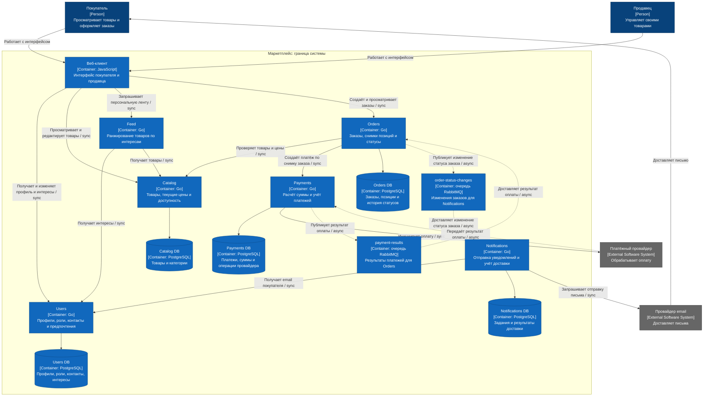

# Архитектура маркетплейса

Архитектура маркетплейса и заготовка сервиса Orders на Go. Сервис отвечает на `GET /health`. Бизнес-логика не реализована.

## Домены и распределение по сервисам

| Домен и сервис | Ответственность и причина выделения | Собственные данные |
| --- | --- | --- |
| Пользователи: Users | Хранит профили, роли, контакты и интересы. Остальные сервисы получают сведения о пользователях здесь | `user_id`, профиль, роли, email, предпочтения |
| Каталог: Catalog | Управляет товарами продавцов. Каталог можно менять отдельно от сервиса заказов | `product_id`, `seller_id`, карточка товара, категория, цена, валюта, доступность |
| Лента: Feed | Подбирает и сортирует товары. Алгоритм выдачи можно менять и масштабировать отдельно | Постоянных данных нет. Получает интересы из Users и товары из Catalog |
| Заказы: Orders | Оформляет заказы и меняет их статусы. Сохраняет историю покупки независимо от изменений каталога | `order_id`, `buyer_id`, позиции со снимками названий и цен, количество, валюта, `payment_id`, статус и история |
| Платежи: Payments | Рассчитывает сумму, учитывает платежи и обращается к платёжному провайдеру. Данные об оплате хранятся отдельно от заказа | `payment_id`, `order_id`, сумма, валюта, попытки оплаты, статусы, идентификаторы операций провайдера |
| Уведомления: Notifications | Отправляет уведомления о статусах заказов. Доставка сообщений не задерживает оформление заказа | Задания на отправку, адрес получателя, попытки и результаты отправки |

Пользователь выбирает категории, которые ему интересны. Feed показывает товары из этих категорий первыми. Если категории не выбраны, товары сортируются по новизне.

## Владение данными

У Users, Catalog, Orders, Payments и Notifications отдельные базы PostgreSQL. Каждый сервис читает и изменяет только свою базу. Общих таблиц и доступа к чужим базам нет. Feed работает без базы.

Catalog хранит текущие цены товаров. Orders сохраняет названия и цены на момент оформления заказа. Payments рассчитывает сумму по сохранённым ценам и хранит статус платежа. Статус заказа хранится в Orders.

Взаимодействия сервисов показаны на C4-диаграмме с подписями `sync` и `async`.

## Альтернативные варианты декомпозиции

**Вариант 1: модульный монолит.** Users, Catalog, Feed, Orders, Payments и Notifications работают как модули одного приложения. У каждого модуля свои таблицы в одной базе. Модули вызывают друг друга внутри процесса. Приложение собирается, выпускается и масштабируется целиком.

**Вариант 2: шесть микросервисов.** Каждый домен представлен отдельным приложением. У каждого сервиса с постоянными данными своя база, у Feed базы нет. Сервисы взаимодействуют через API и очереди, выпускаются и масштабируются отдельно.

## Плюсы, минусы и компромиссы вариантов

| Вариант | Плюсы | Минусы | Компромисс |
| --- | --- | --- | --- |
| Модульный монолит | Одно приложение для запуска. Вызовы между модулями без сети. Изменения данных можно объединить в одну транзакцию | Изменение Feed требует выпуска всего приложения. При росте нагрузки на ленту масштабируется всё приложение | Проще запускать и передавать данные, но нельзя отдельно выпускать и масштабировать модули |
| Шесть микросервисов | Feed можно выпускать и масштабировать отдельно. У сервисов свои базы. Уведомления обрабатываются отдельно от заказов | Нужно запускать несколько приложений и очереди. Вызовы по сети могут завершаться ошибкой. Изменения в разных базах не объединяются одной транзакцией | Сервисы выпускаются и масштабируются независимо, но их сложнее развёртывать и связывать между собой |

## Обоснование финального выбора

Выбран вариант 2: шесть микросервисов.

- В задании перечислены шесть функций: пользователи, каталог, лента, заказы, платежи и уведомления. Каждой соответствует свой сервис.
- Алгоритм персонализации не задан. Его можно менять в Feed без выпуска сервисов заказов и платежей.
- Notifications получает изменения статуса заказа через очередь. Оформление заказа не ждёт отправки письма.
- Каждый сервис владеет своими данными. Общих баз между сервисами нет, как и требуется в задании.

Микросервисы сложнее запускать и сопровождать, зато каждый можно менять отдельно. Высокая нагрузка в задании не указана, поэтому сама по себе не служит причиной этого выбора.

В Docker запускается только заготовка Orders с `/health`. Остальные части системы показаны на схеме.

## C4 Container диаграмма

[Диаграмма SVG](docs/c4-container.svg) · [Исходник Mermaid](docs/c4-container.mmd)

`sync` означает синхронное взаимодействие, `async` означает асинхронное. Стрелки от сервисов к базам обозначают чтение и запись данных. Рамка показывает границу маркетплейса.

<!-- c4-diagram:start -->

<!-- c4-diagram:end -->

## Запуск в Docker

Требования: установленный и запущенный Docker, свободный порт 8080. Команды выполняются из корня репозитория.

Собрать образ:

```sh
docker build -t marketplace-orders:local .
```

Запустить сервис:

```sh
docker run --detach --rm --name marketplace-orders -p 127.0.0.1:8080:8080 marketplace-orders:local
```

Проверить health-check:

```sh
curl --fail -i http://127.0.0.1:8080/health
```

Ожидаемый ответ: `200 OK`, тело `ok`.

Остановить сервис:

```sh
docker stop marketplace-orders
```
